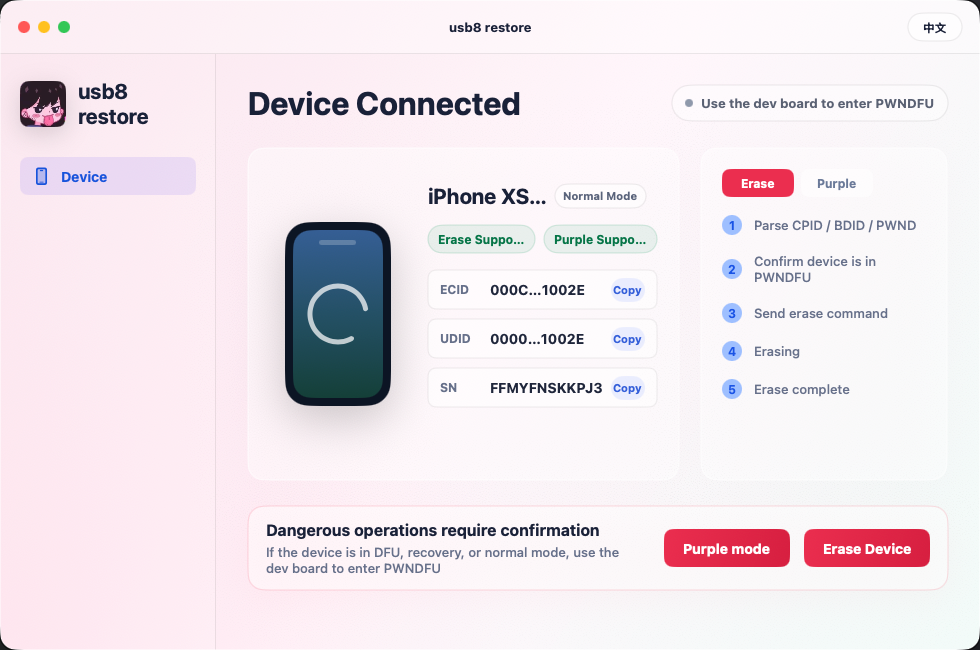

# usb8-restore

A SwiftUI macOS app for booting supported Apple devices in PWNDFU and running usb8 restore / Purple mode workflows.

If this project is useful to you, optional support is welcome: `TNiSqoGMrXaPQUwYKkTQfzn7FhDKo22zMR` (`TRC20`).

## Features

- Detect connected Apple devices in normal, recovery, DFU, and PWNDFU modes.
- Display model, mode, ECID, UDID, and serial number when available.
- Copy ECID / UDID / SN from the UI.
- Run the `Erase Device` workflow on supported devices.
- Run the `Purple mode` workflow on supported devices.
- Bundled helper tools and encrypted boot / Purple assets inside the app resources.
- English / Chinese UI switch.
- Supports Apple Silicon and Intel macOS builds.

## Supported macOS

- Minimum: macOS 11.5
- Recommended: macOS 12 or newer
- Build tested with current Xcode / Swift toolchain on macOS.

## Supported devices

### Erase Device

- iPhone XR
- iPhone XS
- iPhone XS Max
- iPhone 11
- iPhone 11 Pro
- iPhone 11 Pro Max
- iPhone SE 2
- iPad mini 5
- iPad Air 3
- iPad 8

### Purple mode

- iPhone XR
- iPhone XS
- iPhone XS Max
- iPhone 11
- iPhone 11 Pro
- iPhone 11 Pro Max
- iPhone SE 2
- iPad mini 5
- iPad Air 3
- iPad 8
- iPad 9

> `iPad 9` is supported for Purple mode only.

## Requirements

- macOS 11.5+
- Xcode
- XcodeGen, if you want to regenerate the Xcode project:

```sh
brew install xcodegen
```

## Build

Project path:

```sh
cd "usb8-restore"
```

Regenerate the Xcode project:

```sh
xcodegen generate
```

### Build with SwiftPM

```sh
swift build
swift test
```

### Build arm64

```sh
xcodebuild \
  -project usb8-restore.xcodeproj \
  -scheme usb8-restore \
  -configuration Release \
  -destination 'platform=macOS,arch=arm64' \
  -derivedDataPath Dist/Build-arm64 \
  build
```

Output app:

```sh
Dist/Build-arm64/Build/Products/Release/usb8 restore.app
```

### Build x86_64

```sh
xcodebuild \
  -project usb8-restore.xcodeproj \
  -scheme usb8-restore \
  -configuration Release \
  -destination 'platform=macOS,arch=x86_64' \
  -derivedDataPath Dist/Build-x86_64 \
  build
```

Output app:

```sh
Dist/Build-x86_64/Build/Products/Release/usb8 restore.app
```

## Project layout

```text
Sources/Usb8RestoreSwift/App        SwiftUI app and view model
Sources/Usb8RestoreSwift/Models     Device models and support tables
Sources/Usb8RestoreSwift/Services   Device detection and workflow services
Sources/Usb8RestoreSwift/Resources  Bundled tools and encrypted assets
Tests/Usb8RestoreSwiftTests         Unit tests
Scripts                             Helper scripts
```
